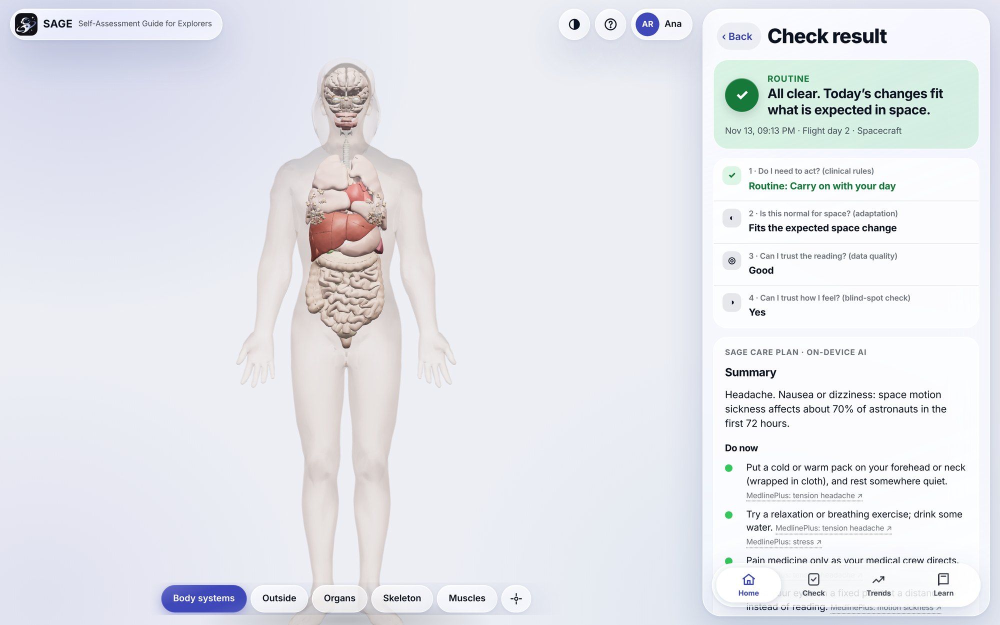

# SAGE: Self-Assessment Guide for Explorers

**On Mars, the nearest doctor is up to 44 minutes away. SAGE gives an astronaut an answer in about 2.**

SAGE is a daily two-minute health check for astronauts, with a view for the medical crew. It learns each astronaut's own normal, knows what is expected on each mission day, and works with no internet.

Team Snoopy's O2 · NASA Space Apps Challenge 2026 · Challenge: *Create Health Monitoring Software for Astronauts on Space Missions*

**Live demo:** https://lighthearted-capybara-6920c9.netlify.app · **Evidence:** [how we tested SAGE on real NASA data](VALIDATION.md)

## Try it in 10 seconds

Open the live demo, or download `SAGE.html` and double-click it: the whole app is in that one file, with no install and no internet. On the sign-in screen, tap **Open the demo astronaut** or **Open the medical crew view**. Both open with no PIN and no made-up health data: you enter the readings.

## The problem

- A message between Mars and Earth takes up to 22 minutes each way, so the astronaut is the first doctor.
- Space changes the body in ways that look like illness: about 70% of astronauts get space motion sickness in the first 72 hours.
- One "normal range" for everyone fails: it raises alarms for normal space changes and misses a change that is big for one person.

## What SAGE does

After every check, SAGE gives four separate answers, then explains what happened, the possible causes (with sources) and what to do now, in 30 minutes and later today. It never diagnoses or doses a medicine.

| # | Question | How SAGE answers |
|---|---|---|
| 1 | Do I need to act? | Cited clinical rules (NEWS2, blood pressure, fever, low blood sugar, red-flag symptoms). Space can never lower this answer. |
| 2 | Is this normal for space? | Compares the reading with the published change for that mission day. |
| 3 | Can I trust the reading? | A missing value is unknown, not healthy. Likely measuring mistakes are flagged. |
| 4 | Can I trust how I feel? | A reaction game checks whether you are slower than you feel. |

Also: a 3D body with 13 organ reports, radiation by location, an approximate bone estimate, trends, points and patches, a medical crew view, live NASA ISS cabin CO₂ and NASA solar-storm alerts. Data stays on the device.

## Evidence

Full method, a worked example and the limits are in **[VALIDATION.md](VALIDATION.md)**.

| What | Result |
|---|---|
| Data | 894 real blood measurements from NASA's 4 Inspiration4 astronauts ([OSD-569](https://osdr.nasa.gov/bio/repo/data/studies/OSD-569), [OSD-575](https://osdr.nasa.gov/bio/repo/data/studies/OSD-575)). No simulated values. |
| Test | Leave one astronaut out: 128 predictions about astronauts SAGE had never seen. |
| Can SAGE's range be trusted? | 120 of 128 real values (93.8%) inside SAGE's 95% range, against 91 of 128 (71.1%) for the astronaut's own average alone. |
| False alarms on a no-flight day | 20 of 128 after calibration, against 39 with textbook variation. |
| Every prediction | [`results/predictions.csv`](results/predictions.csv) and [`results/null_test.csv`](results/null_test.csv) |
| Re-run it (Python 3) | `python3 analysis/train_real.py` then `python3 analysis/export_predictions.py` |

## Files

| File | What it is |
|---|---|
| `SAGE.html` | The whole app in one file |
| `VALIDATION.md` | How we tested SAGE on real NASA data |
| `results/` | The test results: every prediction and every number in our slides |
| `analysis/` | The test code and the real Inspiration4 blood values it uses |

## Limits

SAGE is a research prototype that supports the medical crew; it is not a diagnosis or a medical device. The blood test covers 4 astronauts on one 3-day flight. Organ effects of space radiation come mostly from animal studies.

## Team Snoopy's O2

Shreya (team leader, space researcher) · Jas (coder and AI engineer) · Shreyash (full-stack developer) · Ishika (UI/UX and visualization designer) · Shatakshi (data scientist and analyst)

## NASA data and credits

- NASA Open Science Data Repository: [OSD-569](https://osdr.nasa.gov/bio/repo/data/studies/OSD-569), [OSD-575](https://osdr.nasa.gov/bio/repo/data/studies/OSD-575) and [ISS dosimetry](https://osdr.nasa.gov/bio/repo/)
- NASA DONKI: [solar storm events](https://ccmc.gsfc.nasa.gov/tools/DONKI/)
- NASA ISS Live: [live station telemetry](https://ntrs.nasa.gov/citations/20130013825) for cabin CO₂
- NASA-STD-3001: [crew health standard](https://www.nasa.gov/reference/nasa-std-3001v2/)
- NASA Human Research Program: [hazards](https://www.nasa.gov/hrp/hazards) and [risks](https://www.nasa.gov/hrp/risks/)
- 3D anatomy: BodyParts3D / Anatomography (© Database Center for Life Science, CC BY 4.0) and NIH HuBMAP Visible Human Female (CC BY 4.0)
